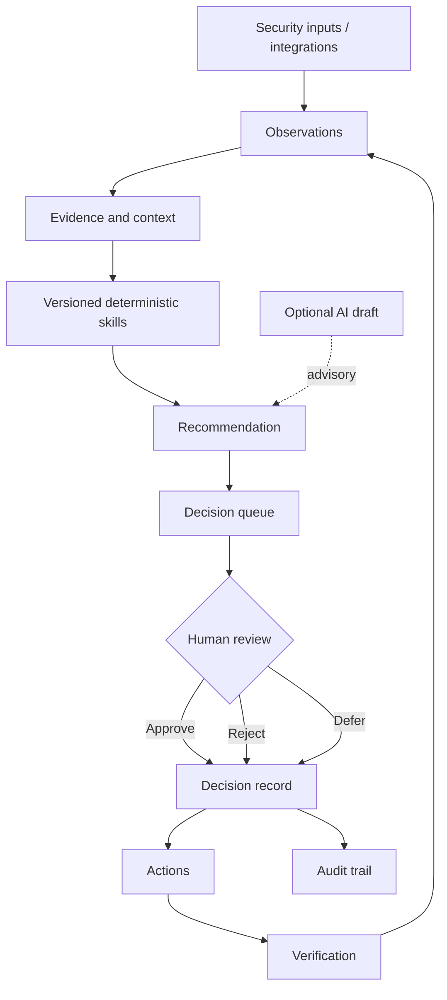

# Astra CISO

**Open-source security decision and evidence infrastructure for security leaders.**

Astra turns vendor assessments, security evidence, and risk signals into **reproducible recommendations and human-approved, auditable decisions**.

Astra is not a SIEM, EDR, vulnerability scanner, or autonomous CISO. It sits above security data sources and helps answer:

> **What needs a decision, why, and what evidence supports it?**

> **Current release:** `v0.1.0` Community Preview. APIs and schema may still change.

## Why Astra?

Security teams already have scanners, GRC platforms, ticketing systems, and cloud tools. The missing layer is often the decision trail:

- What information was available?
- Which deterministic rule produced the recommendation?
- Who approved or rejected it?
- Which evidence supported it?
- What action followed?
- Can the result be reproduced later?

Astra is designed around that loop.



## Core workflows

### Vendor assessment

```text
Questionnaire
    ↓
Knowledge matching
    ↓
CAIQ coverage score
    ↓
Vendor risk tier
    ↓
vendor.goNoGo recommendation
    ↓
PENDING decision
    ↓
Human approval
    ↓
Vendor status + Approval + AuditLog
```

### Evidence freshness

```text
Evidence → evidence.expiry → Needs You → refresh / accept gap → decision
```

### Risk

```text
Likelihood × Impact → risk.fiveByFive → treatment decision → audit trail
```

## Architecture

- **Next.js 16 / React 19 / TypeScript**
- **PostgreSQL 16 / Prisma 7**
- **NextAuth 5** authentication
- **Zod** boundary validation
- **Zustand** for UI state only
- **Versioned deterministic skills** in `src/lib/skills/`
- **Observation** snapshots for external data
- **Decision** records in PostgreSQL
- **Approval + AuditLog** for human decisions
- **Local evidence storage** in Community Preview
- Optional **Anthropic** or **Google Gemini** drafting

The authoritative decision state lives in PostgreSQL. AI output is advisory; it does not automatically approve material security decisions.

## Quickstart

### 1. Clone and configure

```bash
git clone https://github.com/astra-ssj/CISO.git
cd CISO
cp .env.example .env
```

### 2. Start with demo data

```bash
docker compose --profile demo up -d --build
```

### 3. Open Astra

Open **http://localhost:3000**.

The demo seed creates the local evaluation account `ciso@astra.ai / admin123`. It is only created when `ASTRA_MODE=demo`; do not expose a demo deployment to untrusted networks.

No external AI key, SIEM, cloud account, or threat-intelligence API is required to evaluate the core workflow.

## Deterministic skills

Astra skills are versioned and replayable.

| Skill | Purpose |
|---|---|
| `caiq.match` | Match questionnaire questions to approved knowledge |
| `caiq.score` | Calculate deterministic knowledge coverage |
| `vendor.goNoGo` | Produce a recommendation against risk appetite |
| `risk.fiveByFive` | Score likelihood × impact |
| `evidence.expiry` | Identify expired and expiring evidence |
| `caiq.draft` | Label model-generated CAIQ text as non-authoritative draft |

Operational SkillRuns persist the skill ID, version, input hash, output, and time.

**Same input + same skill version = same output.**

## AI

AI is optional.

```env
AI_PROVIDER=NONE
```

Supported providers in the current code:

```text
NONE
ANTHROPIC
GOOGLE
```

When enabled, AI assists with drafting and interpretation. It is not the authority for material security decisions.

## Repository map

```text
src/app/                 Next.js pages and API routes
src/components/          UI components
src/lib/skills/          deterministic security skills
src/lib/observations/    append-only external snapshots
src/lib/auth/            RBAC/session helpers
src/lib/audit/           audit service
src/lib/evidence/        evidence storage
src/lib/integrations/    integration registry
prisma/                  PostgreSQL schema and migrations
tests/                   unit, integration, smoke tests
ops/                     experimental sidecar/operator assets
```

## Community Preview scope

### In scope for v0.1

- Command Center / Needs You
- Decision Center
- Vendor registry and CAIQ workflow
- Knowledge repository
- Evidence vault and expiry
- Risk register / 5×5 scoring
- Policies where they support evidence context
- Skill provenance
- Approval and audit history
- Docker demo path

### Experimental / later

- incident response / War Room
- tabletop exercises
- world/threat intelligence visualization
- attack-surface UI
- strategy / OKRs
- hard-coded executive KPI surfaces
- FAIR as a decision authority
- OpenNeko / GraphJin automation
- additional AI providers

These experimental routes may still exist in the codebase while they are progressively isolated; they are intentionally removed from primary navigation.

## Development

```bash
cp .env.example .env
docker compose up -d postgres
npm ci
npx prisma migrate deploy
npm run dev
```

Run validation:

```bash
npx tsc --noEmit
npm run lint
npm test
npm run test:integration
npm run test:smoke
npm run build
```

## Security

Astra is a Community Preview, not a certified GRC system. See [SECURITY.md](SECURITY.md) for limitations and vulnerability reporting.

## Contributing

See [CONTRIBUTING.md](CONTRIBUTING.md).

Project rule:

> **Empty is honest. Silent mock data is not.**

## Roadmap

### v0.1 — Decision Core (current)

- persistent security decisions
- human approval before execution
- vendor + CAIQ workflow
- evidence and expiry
- deterministic risk scoring
- authorization hardening
- reproducible Docker setup
- real PostgreSQL CI

### v0.2 — Integration foundation

- connector SDK
- GitHub/Jira connector normalization
- storage adapters
- stronger multi-user authorization

### v0.3 — Compliance graph

- versioned framework manifests
- controls and mappings
- evidence-to-control relationships
- evidence freshness and drift

## License

[MIT](LICENSE)
