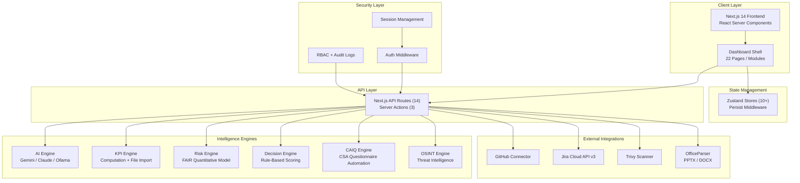
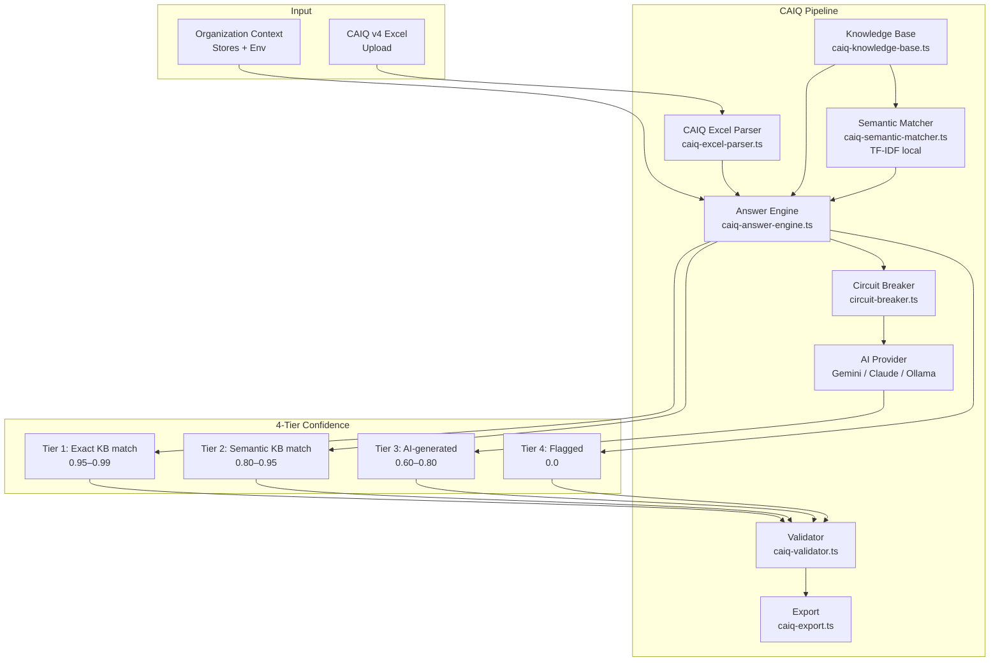
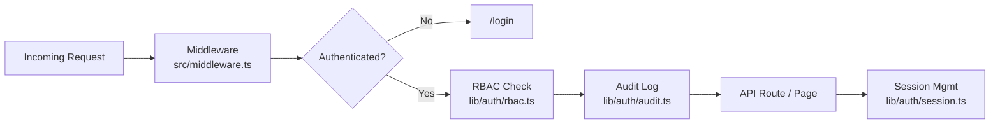
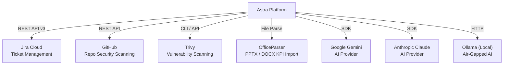

# High-Level Design (HLD) — Astra CISO Platform

**Version**: 2.0  
**Date**: February 18, 2026  
**Status**: Production-Ready (Staging)

---

## 1. System Overview

**Astra CISO** is an AI-powered Governance, Risk, and Compliance (GRC) platform engineered for Chief Information Security Officers. It provides real-time security posture visualization, automated compliance management, threat intelligence, vendor risk assessment, and strategic decision support — all within a unified command center.

### Design Pillars

| Pillar | Description |
|--------|-------------|
| **Agentic AI** | Autonomous agents for policy drafting, threat analysis, CAIQ automation, and OSINT intelligence |
| **Privacy-First Hybrid AI** | Supports Google Gemini, Anthropic Claude, and local Ollama for air-gapped environments |
| **Visual Intelligence** | Nexus Graph topology, traffic flow diagrams, posture gauges, and investment heatmaps |
| **Offline-First Architecture** | All core features work without external APIs via Zustand persistence and local stores |
| **Enterprise Security** | RBAC, audit logging, session management, and middleware-enforced authentication |

---

## 2. Platform Architecture

---

## 3. Module Map

### 3.1 Dashboard Pages (22 Routes)

| Module | Route | Purpose |
|--------|-------|---------|
| **Command Center** | `/` | Executive dashboard with posture gauge, threat map, active metrics |
| **Executive Brief** | `/executive-brief` | Board-ready bento grid with investment heatmap, top risks, revenue velocity |
| **Strategy** | `/strategy` | Security strategy alignment with OKR tracking and KPI rows |
| **Defense Matrix** | `/strategy/matrix` | High-density compliance control grid with status pills and filters |
| **KPI Dashboard** | `/kpis` | 20 auto-computed KPIs + file-imported KPIs with confidence scoring |
| **Projects & OKRs** | `/projects` | Project tracking with progress, milestones, and team assignments |
| **Decisions** | `/decisions` | AI-assisted decision support with scoring and recommendation engine |
| **Risk** | `/risk` | Risk register with FAIR-based quantitative analysis |
| **Governance** | `/governance` | Policy lifecycle management with evidence vault |
| **Policies** | `/policies` | Policy editor with Kanban workflow and dependency graphs |
| **Compliance** | `/appsec` | Application security posture and SAST findings |
| **Incidents** | `/incidents` | Incident timeline and response tracking |
| **War Room** | `/incidents/war-room` | Real-time war room for active incident response |
| **War Games** | `/wargames` | 10 attack scenarios with MITRE ATT&CK mapping and AAR |
| **Intelligence** | `/intelligence` | Threat intelligence feed with MITRE matrix and system health |
| **Ransomware Intel** | `/intelligence/ransomware` | Ransomware group monitoring and victim tracking |
| **Vendors** | `/vendors` | Third-party vendor risk management with CAIQ automation |
| **Tickets** | `/tickets` | Jira-integrated ticketing with 15 CISO templates |
| **Budget** | `/budget` | Security budget and financial planning dashboard |
| **Reporting** | `/reporting` | Board deck generator and export tools |
| **Settings** | `/settings` | Platform configuration and preferences |
| **Help** | `/help` | Knowledge base and platform documentation |

### 3.2 API Routes (14 Endpoints)

| Endpoint | Method | Purpose |
|----------|--------|---------|
| `/api/agent/chat` | POST | General CISO AI assistant |
| `/api/agent/wargame` | POST | War game simulation engine |
| `/api/agent/generate-policy` | POST | AI-powered policy drafting |
| `/api/agent/analyze` | POST | Threat/request analysis |
| `/api/agent/analyze-policy` | POST | Policy gap analysis |
| `/api/notebook/chat` | POST | Notebook-style AI conversations |
| `/api/intelligence/osint` | POST | OSINT threat intelligence gathering |
| `/api/kpi-upload` | POST | PPTX/DOCX file upload and KPI extraction |
| `/api/jira` | GET/POST | Jira connection check and ticket creation |
| `/api/vendors/caiq` | POST | CSA CAIQ questionnaire automation |
| `/api/security/scan` | POST | Security configuration scanning |
| `/api/security/audit` | GET | Audit log retrieval |
| `/api/auth/login` | POST | Authentication endpoint |
| `/api/integrations/trivy` | GET | Trivy vulnerability scanner integration |

### 3.3 Intelligence Engines (6 Engines)

| Engine | File | Purpose |
|--------|------|---------|
| **AI Engine** | `lib/ai/engine.ts` | Multi-provider AI client (Gemini, Claude, Ollama) |
| **KPI Engine** | `lib/kpi-engine/kpi-engine.ts` | Computes 20 security KPIs across 8 categories |
| **KPI Extractor** | `lib/kpi-engine/kpi-extractor.ts` | Regex/heuristic extraction from PPTX/DOCX (35+ patterns) |
| **Risk Engine** | `lib/risk-engine/fair.ts` | FAIR-model quantitative risk analysis (ALE, SLE, ARO) |
| **Decision Engine** | `lib/decision-engine/router.ts` | Rule-based scoring with confidence and impact modeling |
| **CAIQ Engine** | `lib/caiq/caiq-answer-engine.ts` | Automated CSA CAIQ questionnaire responses (4-tier pipeline) |
| **OSINT Engine** | `lib/ai/osint-engine.ts` | Open-source intelligence gathering and analysis |

### 3.4 CAIQ Module Architecture

The CAIQ (Consensus Assessments Initiative Questionnaire) module automates CSA CAIQ v4 vendor assessments with a 4-tier confidence pipeline and optional validation/export.

**4-tier confidence system**

| Tier | Name | Source | Confidence | Description |
|------|------|--------|------------|-------------|
| 1 | EXACT_MATCH | Knowledge base by question ID | 0.95–0.99 | Direct KB hit; org overrides and evidence applied. |
| 2 | SEMANTIC_MATCH | KB via TF-IDF/cosine similarity | 0.80–0.95 | Local matcher (`CAIQSemanticMatcher`); no external API. |
| 3 | AI_GENERATED | Primary or fallback AI | 0.60–0.80 | Circuit breaker gates calls; fallback provider optional. |
| 4 | FLAGGED | — | 0.0 | Human must answer; no KB or AI result. |

**Circuit breaker pattern**

- **Purpose**: Avoid cascading failures when the AI provider is down or rate-limited.
- **State**: Per-provider state is `closed` (healthy), `open` (failing; no calls), or `half-open` (probing).
- **Usage**: Answer engine and validator check `getCircuitState(provider)` before calling AI. On failure, `setCircuitState(provider, 'open')` is called; optional secondary provider is tried.
- **Health**: Health check API exposes `getAllCircuitBreakerMetrics()` for AI availability.

**CAIQ component list**

| Component | File | Purpose |
|-----------|------|---------|
| **Types** | `lib/caiq/types.ts` | CAIQ domains, answer types, confidence tiers, OrgContext, ParsedCAIQ*, ValidationResult |
| **Knowledge Base** | `lib/caiq/caiq-knowledge-base.ts` | CAIQ v4 KB entries, getEntryByQuestionId, getEntriesByDomain |
| **Excel Parser** | `lib/caiq/caiq-excel-parser.ts` | Parse/write CAIQ v4 Excel; column detection; existing answers |
| **Semantic Matcher** | `lib/caiq/caiq-semantic-matcher.ts` | Local TF-IDF + cosine similarity for Tier 2 |
| **Answer Engine** | `lib/caiq/caiq-answer-engine.ts` | 4-tier pipeline; org context; circuit breaker; audit |
| **Validator** | `lib/caiq/caiq-validator.ts` | Alignment, consistency, evidence, framework mapping, AI self-check |
| **Org Context** | `lib/caiq/caiq-org-context.ts` | buildOrgContext from stores + env; getRelevantControls; getEvidenceForQuestion |
| **Export** | `lib/caiq/caiq-export.ts` | exportToCAIQExcel (v4); exportToAuditPDF |
| **Transfer Engine** | `lib/caiq/caiq-transfer-engine.ts` | Source-to-target Q&A transfer (3-tier match + AI) |
| **Metrics** | `lib/caiq/caiq-metrics.ts` | In-memory last assessment, coverage, pending review |
| **Circuit Breaker** | `lib/ai/circuit-breaker.ts` | get/set circuit state per AI provider; health metrics |

### 3.5 State Stores (10+ Zustand Stores)

| Store | File | Persistence |
|-------|------|-------------|
| **Main Store** | `lib/store.ts` | ✅ `astra-store` |
| **Jira Store** | `lib/jira/jira-store.ts` | ✅ `astra-jira-tickets` |
| **Uploaded KPI Store** | `lib/kpi-engine/uploaded-kpi-store.ts` | ✅ `astra-uploaded-kpis` |
| **OKR/Project Store** | `lib/okr-project-store.ts` | ✅ `astra-okr-projects` |
| **Notification Store** | `lib/notification-store.ts` | ✅ `astra-notifications` |
| **Risk Register** | `lib/risk-register-store.ts` | ✅ `astra-risk-register` |
| **Vendor Risk Store** | `lib/vendor-risk-store.ts` | ✅ `astra-vendor-risk` |
| **Evidence Store** | `lib/evidence-store.ts` | ✅ `astra-evidence` |
| **Policy Store** | `lib/policy-store.ts` | ✅ |
| **Playbook Store** | `lib/playbook-store.ts` | ✅ |
| **AppSec Store** | `lib/appsec-store.ts` | ✅ |

---

## 4. Security Architecture

| Layer | Implementation | Status |
|-------|---------------|--------|
| **Authentication** | Cookie-based session with middleware enforcement | ✅ Active |
| **Authorization** | Role-based access control (Admin, Analyst, Viewer) | ✅ Active |
| **Audit Trail** | Structured event logging with user/action/resource tracking | ✅ Active |
| **Session Management** | Secure token handling with expiry and refresh | ✅ Active |
| **API Security** | Input validation, type checking, error sanitization | ✅ Active |
| **Secrets Management** | Server-side only env vars, no client-side key exposure | ✅ Active |

---

## 5. External Integration Architecture

---

## 6. Technology Stack

| Layer | Technology | Version |
|-------|-----------|---------|
| **Framework** | Next.js (App Router) | 14.x |
| **Language** | TypeScript | 5.x |
| **UI Library** | React | 18.x |
| **State** | Zustand + Persist | 4.x |
| **UI Components** | Radix UI + shadcn/ui | Latest |
| **Styling** | Tailwind CSS | 3.x |
| **AI** | Google Generative AI SDK, Anthropic SDK | Latest |
| **Animation** | Framer Motion | Latest |
| **Charts** | Recharts | Latest |
| **Icons** | Lucide React | Latest |
| **Document Parsing** | OfficeParser | 5.x |
| **Auth** | Custom middleware + RBAC | Custom |

---

## 7. Deployment Architecture

- **Development**: `npm run dev` — Hot reload on `localhost:3000`
- **Build**: `npx next build` — Static + dynamic page compilation
- **Production**: Node.js server or serverless (Vercel-compatible)
- **Environment**: Requires `GOOGLE_API_KEY` or `ANTHROPIC_API_KEY` for AI features
- **Offline Mode**: Full functionality except AI endpoints (graceful degradation)
