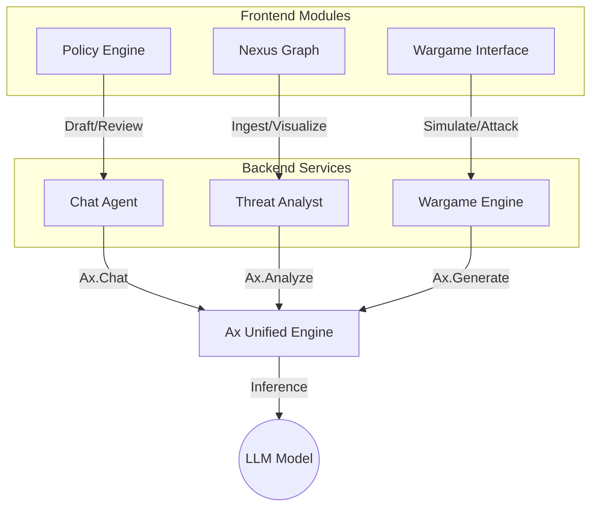

# High-Level Design (HLD) - Astra CISO

## 1. System Overview

**Astra CISO** is an advanced AI-powered Governance, Risk, and Compliance (GRC) platform designed to assist Chief Information Security Officers (CISOs). It provides real-time visualization of security posture (Nexus Graph), automates policy management, runs red-team simulations (Wargames), and offers strategic intelligence via a sophisticated AI agentic architecture.

**Key Design Philosophy:**

- **Agentic AI**: Moving beyond simple chat, the system uses autonomous agents to draft policies, analyze threats, and simulate attacks.
- **Privacy-First Hybrid AI**: Supports both local LLMs (Ollama) for sensitive data and cloud LLMs (OpenAI) for complex reasoning.
- **Visual Intelligence**: Heavy emphasis on innovative data visualization (Nexus Graph, Policy Dependency Graph) to make complex risk data actionable.

## 2. System Architecture

The application is built on a modern **Next.js 14** stack, utilizing React Server Components for performance and a unified AI Engine layer.

### High-Level Architecture Diagram

```mermaid
graph TD
    User[User CISO] -->|Interact| UI[Next.js Frontend]
    UI -->|API Calls| API[Next.js API Routes / Server Actions]
    
    subgraph "Application Core"
        UI -->|State Mgmt| Zustand[Zustand Stores]
        API -->|Logic| Agents[AI Agents Routes]
    end
    
    subgraph "AI Layer (Unified Ax Engine)"
        Agents -->|Request| AxEngine[src/lib/ai/engine.ts]
        AxEngine -->|Switch| Provider{Provider Selector}
        Provider -->|Local| Ollama[Ollama (Llama3)]
        Provider -->|Cloud| OpenAI[OpenAI (GPT-4o)]
    end
    
    subgraph "Data Layer"
        Agents -->|Read/Write| MockDB[Mock Data / Constants]
        UI -->|Read| Stores[Policy/Unification Stores]
    end
```

## 3. Key Components

### 3.1 Frontend (Client-Side)

- **Dashboard Shell**: Responsive layout with global navigation and "Demon Mode" (immersive silent mode).
- **Nexus Graph (`src/components/nexus`)**: A physics-based visualization of the link between Business Units, Applications, and Infrastructure. Highlights critical paths and risks.
- **Policy Engine**: A Kanban-style interface for managing policy lifecycles, supported by a Dependency Graph to show cascading effects of policy changes.
- **Wargame Interface**: A chat-based terminal for simulating red-team/blue-team scenarios.

### 3.2 Backend (Server-Side)

- **API Routes (`src/app/api/agent/*`)**: specialized endpoints for different agent capabilities:
  - `/chat`: General purpose CISO assistant.
  - `/wargame`: Adversarial simulation agent.
  - `/analyze`: Security request analyzer.
  - `/generate-policy`: Automated policy drafter.
- **Server Actions**: Used for direct mutations and AI operations like `legal-ai.ts` (clause analysis) and `ai-ops.ts` (threat remediation).

### 3.3 AI Engine (The Brain)

- **Unified Client (`src/lib/ai/engine.ts`)**: A singleton instance of `@ax-llm/ax`.
- **Abstraction**: Handles model differences, prompt construction, and response parsing.
- **Configuration**: Dynamically switches between Local and Cloud providers based on environment variables (`NEXT_PUBLIC_USE_OLLAMA`).

### Component Interaction Diagram



## 4. Data Flow

### Scenario: Policy Generation

1. **User Action**: User requests a new "Access Control Policy" via the UI.
2. **API Call**: Frontend sends request to `/api/agent/generate-policy`.
3. **AI Processing**:
    - The route constructs a specialized prompt with the *Policy Architect* persona.
    - `AxEngine` forwards the prompt to the active LLM (e.g., GPT-4o).
4. **Structured Output**: The LLM returns a markdown-formatted policy structure.
5. **Response**: The API returns the content, which is streamed or rendered into the Policy Editor.

### Scenario: Nexus Threat Detection

1. **Ingestion**: `DataIngestionPanel` accepts upload (simulated).
2. **Analysis**: Client-side logic (future server-side) parses topology.
3. **Visualization**: `NexusGraph` renders nodes.
4. **Risk Overlay**: If a threat is detected (e.g., CVE matching), the node is flagged red, and the ripple effect is visualized on the graph.

## 5. Security & Privacy Design

- **Local-First Capabilities**: By supporting Ollama, the entire app can run offline or in an air-gapped environment, ensuring zero data exfiltration.
- **Environment Isolation**: API keys are server-side only. Client-side flags (`NEXT_PUBLIC_*`) only control non-sensitive configuration.
- **Mock Authentication**: Currently uses a lightweight store-based auth simulation (`useAstraStore`), ready to be replaced by NextAuth.js or OAuth providers.
