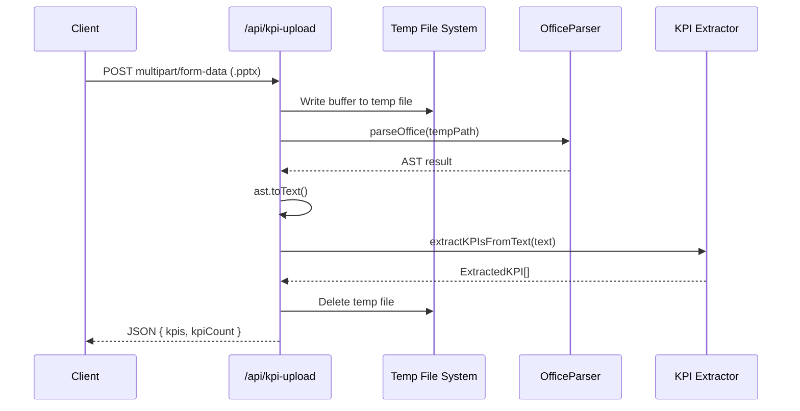
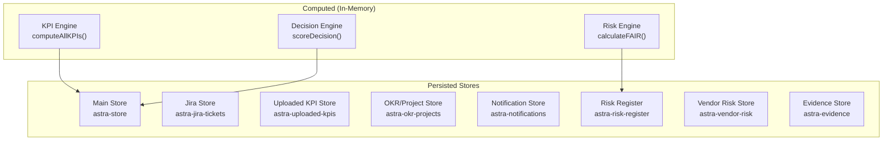

# Low-Level Design (LLD) — Astra CISO Platform

**Version**: 2.0  
**Date**: February 18, 2026

---

## 1. Directory Structure

```
src/
├── app/
│   ├── (dashboard)/              # Protected dashboard routes (22 pages)
│   │   ├── page.tsx              # Main command center
│   │   ├── executive-brief/      # Board-ready executive dashboard
│   │   ├── strategy/             # Strategy alignment + Defense Matrix
│   │   ├── kpis/                 # KPI dashboard with file import
│   │   ├── projects/             # OKR & project tracking
│   │   ├── decisions/            # AI-assisted decision engine
│   │   ├── risk/                 # Risk register (FAIR model)
│   │   ├── governance/           # Policy governance + evidence vault
│   │   ├── policies/             # Policy editor with Kanban
│   │   ├── incidents/            # Incident timeline + war room
│   │   ├── wargames/             # War games + AI + scenario builder
│   │   ├── intelligence/         # Threat intel + ransomware monitoring
│   │   ├── vendors/              # Vendor risk + CAIQ automation
│   │   ├── tickets/              # Jira-integrated ticketing
│   │   ├── budget/               # Budget & financial planning
│   │   ├── reporting/            # Board deck generation
│   │   ├── appsec/               # Application security posture
│   │   ├── infrastructure/       # Infrastructure overview
│   │   ├── privacy/              # Privacy controls
│   │   ├── settings/             # Platform config
│   │   ├── help/                 # Knowledge base
│   │   └── layout.tsx            # Dashboard shell wrapper
│   ├── api/
│   │   ├── agent/                # AI agent routes (chat, wargame, policy, analyze)
│   │   ├── auth/login/           # Authentication
│   │   ├── intelligence/osint/   # OSINT intelligence
│   │   ├── jira/                 # Jira integration proxy
│   │   ├── kpi-upload/           # File upload + KPI extraction
│   │   ├── notebook/chat/        # Notebook AI conversations
│   │   ├── security/             # Audit + scan routes
│   │   ├── vendors/caiq/         # CSA CAIQ automation
│   │   └── integrations/trivy/   # Vulnerability scanning
│   ├── actions/                  # Server actions (ai-ops, legal-ai, war-room-ai)
│   ├── login/                    # Login page
│   ├── globals.css               # Global styles + design tokens
│   └── layout.tsx                # Root layout
├── components/
│   ├── layout/                   # Shell, sidebar, navigation
│   ├── dashboard/                # Posture gauge, vuln feed, threat map
│   ├── executive/                # Investment heatmap, top risks, velocity gauge
│   ├── strategy/                 # KPI row, OKR card, uploader, matrix
│   ├── decisions/                # Decision card component
│   ├── governance/               # Evidence vault
│   ├── incidents/                # Incident timeline
│   ├── intelligence/             # MITRE matrix, threat ticker, ransomware stats
│   ├── nexus/                    # Infrastructure topology graph
│   ├── notifications/            # Notification center
│   ├── policies/                 # Policy editor, Kanban, dependency graph
│   ├── reporting/                # Board deck generator, export button
│   ├── risk/                     # Risk cards and visualizations
│   ├── security/                 # Audit log viewer
│   ├── visualizations/           # Access graph, traffic flow
│   ├── ui/                       # Shadcn/ui primitives (Button, Card, Badge, etc.)
│   └── war-room/                 # War room chat components
├── lib/
│   ├── ai/                       # AI engine, OSINT, verification
│   ├── auth/                     # RBAC, audit, session management
│   ├── caiq/                     # CAIQ answer engine + knowledge base
│   ├── connectors/               # GitHub connector
│   ├── decision-engine/          # Decision types + routing logic
│   ├── jira/                     # Jira connector, store, templates
│   ├── kpi-engine/               # KPI computation, extraction, uploaded store
│   ├── risk-engine/              # FAIR quantitative model
│   ├── logging/                  # Sentinel logger
│   ├── trivy/                    # Vulnerability scanner wrapper
│   ├── store.ts                  # Main Zustand store
│   ├── governance.ts             # Governance data & logic
│   ├── compliance-frameworks.ts  # Framework control definitions
│   ├── vendor-risk-store.ts      # Vendor risk Zustand store
│   ├── risk-register-store.ts    # Risk register Zustand store
│   ├── notification-store.ts     # Notifications Zustand store
│   ├── okr-project-store.ts      # OKR/project tracking store
│   ├── evidence-store.ts         # Evidence vault store
│   ├── posture-score.ts          # Security posture calculator
│   └── ...                       # Additional engines and utilities
├── stores/                       # Legacy store location
├── types/                        # TypeScript type definitions
└── middleware.ts                 # Auth middleware (route protection)
```

---

## 2. API Specifications

### 2.1 AI Agent Routes

#### POST `/api/agent/chat`

- **Input**: `{ message: string, history: Message[], context?: string }`
- **Output**: `{ response: string, type: 'text' | 'structured' }`
- **Logic**: Constructs CISO persona prompt → AI engine inference → parsed response
- **Fallback**: Returns graceful error message if AI provider unavailable

#### POST `/api/agent/wargame`

- **Input**: `{ turnId: string, playerAction: string, currentGameState: State }`
- **Output**: `{ narrative: string, metricsDelta: { budget, trust, morale } }`
- **Logic**: Injects Red Team persona → evaluates player action → generates outcome

#### POST `/api/agent/generate-policy`

- **Input**: `{ title: string, type: string, strictness: 'high' | 'medium' | 'low' }`
- **Output**: `{ content: string }` (markdown policy draft)

#### POST `/api/agent/analyze-policy`

- **Input**: `{ policyId: string, framework?: string }`
- **Output**: `{ gaps: Gap[], recommendations: string[], score: number }`

### 2.2 Integration Routes

#### POST `/api/kpi-upload`

- **Input**: `multipart/form-data` with `.pptx` or `.docx` file
- **Output**: `{ kpis: ExtractedKPI[], kpiCount: number, extractedText: string }`
- **Flow**: File → temp disk with extension → OfficeParser AST → `.toText()` → regex extractor



#### GET/POST `/api/jira`

- **GET**: Tests Jira connection → returns `{ connected: boolean }`
- **POST**: Creates Jira issue → returns `{ id, key, url }` or falls back to local mode
- **Auth**: Uses `JIRA_BASE_URL`, `JIRA_API_TOKEN`, `JIRA_EMAIL`, `JIRA_PROJECT_KEY`

#### POST `/api/vendors/caiq`

- **Input**: `{ vendorId: string, questionIds?: string[] }`
- **Output**: `{ answers: CAIQAnswer[], completionRate: number }`

#### POST `/api/intelligence/osint`

- **Input**: `{ query: string, sources?: string[] }`
- **Output**: `{ threats: Threat[], indicators: IOC[], confidence: number }`

---

## 3. Core Data Models

### 3.1 KPI (Key Performance Indicator)

```typescript
interface KPI {
    id: string;
    name: string;
    value: number;
    target: number;
    unit: string;
    category: 'RISK' | 'COMPLIANCE' | 'INCIDENT' | 'VULNERABILITY' |
              'VENDOR' | 'PEOPLE' | 'BUDGET' | 'POSTURE';
    health: 'GREEN' | 'AMBER' | 'RED';
    trend: 'IMPROVING' | 'STABLE' | 'DECLINING';
    benchmarkPercentile?: number;
    sparklineData?: number[];
}
```

### 3.2 Jira Ticket Template

```typescript
interface TicketTemplate {
    id: string;
    title: string;
    category: 'incident' | 'risk' | 'infrastructure' | 'vendor' | 'strategic';
    description: string;     // Markdown
    priority: 'Critical' | 'High' | 'Medium' | 'Low';
    labels: string[];
    customFields: Record<string, string>;
    suggestedAssignee: string;
}
```

### 3.3 Decision

```typescript
interface Decision {
    id: string;
    title: string;
    category: string;
    priority: 'critical' | 'high' | 'medium' | 'low';
    impact: number;          // 1-100
    confidence: number;      // 1-100
    status: 'pending' | 'approved' | 'rejected' | 'deferred';
    recommendation: string;
    alternatives: Alternative[];
}
```

### 3.4 Vendor Risk Assessment

```typescript
interface VendorRisk {
    id: string;
    vendorName: string;
    riskScore: number;       // 0-100
    criticality: 'critical' | 'high' | 'medium' | 'low';
    lastAssessment: string;  // ISO date
    caiqStatus: 'pending' | 'in-progress' | 'completed';
    findings: Finding[];
    complianceStatus: Record<string, boolean>;
}
```

### 3.5 RBAC Permission

```typescript
interface Permission {
    resource: string;
    actions: ('read' | 'write' | 'delete' | 'admin')[];
}

interface Role {
    name: 'admin' | 'analyst' | 'viewer';
    permissions: Permission[];
}
```

---

## 4. State Management Architecture

All stores use **Zustand** with `persist` middleware for browser localStorage.



---

## 5. Security Middleware Flow

```typescript
// src/middleware.ts — simplified flow
export function middleware(request: NextRequest) {
    const { pathname } = request.nextUrl;

    // 1. Skip public routes (/login, /api/auth/*, /_next/*, static assets)
    if (isPublicRoute(pathname)) return NextResponse.next();

    // 2. Check authentication cookie
    const session = request.cookies.get('astra-session');
    if (!session) return redirect('/login');

    // 3. Validate session token
    const valid = validateSession(session.value);
    if (!valid) return redirect('/login');

    // 4. Apply security headers
    const response = NextResponse.next();
    response.headers.set('X-Frame-Options', 'DENY');
    response.headers.set('X-Content-Type-Options', 'nosniff');
    response.headers.set('Referrer-Policy', 'strict-origin-when-cross-origin');

    return response;
}
```

---

## 6. AI Engine Configuration

```typescript
// src/lib/ai/engine.ts — Multi-provider abstraction
// Supports: Google Gemini, Anthropic Claude, Ollama (local)

// Provider selection priority:
// 1. GOOGLE_API_KEY → Gemini Pro
// 2. ANTHROPIC_API_KEY → Claude 3 Haiku
// 3. NEXT_PUBLIC_USE_OLLAMA → Ollama (Llama3)
// 4. Fallback → Graceful error with mock/default responses
```

---

## 7. KPI Extraction Pipeline

```typescript
// Phase 1: Known patterns (35+ regex)
// Matches: MTTD, MTTR, compliance %, patch rates, budgets, etc.
// Confidence: 60-95% based on context specificity

// Phase 2: Generic fallback (if <3 matches)
// Matches: "Label: Number" or "Number% text" anywhere
// Confidence: 35% (lower, requires manual review)

// Number extraction handles:
// $4.2M, $500K, 92%, 4.2 hours, 12 days, plain integers
```
