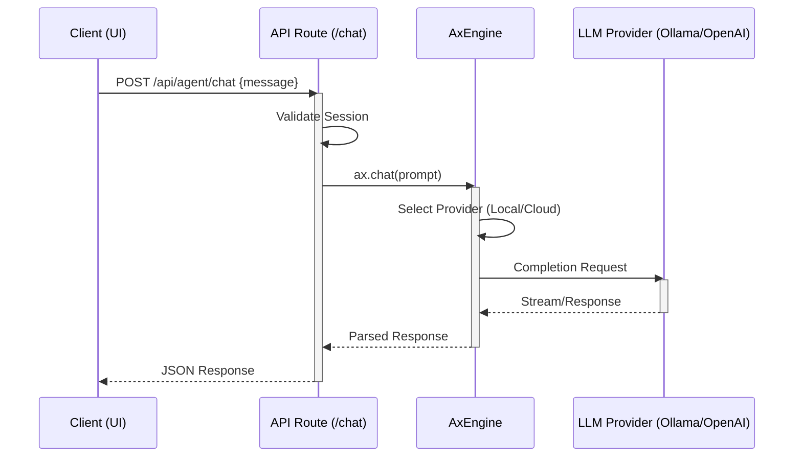

# Low-Level Design (LLD) - Astra CISO

## 1. Directory Structure & Modules

The codebase follows a modular Next.js App Router structure.

```
src/
├── app/
│   ├── (dashboard)/        # Protected routes (shell, navigation)
│   ├── api/agent/          # AI Agent endpoints
│   ├── layout.tsx          # Root layout
│   └── page.tsx            # Landing/Auth page
├── components/
│   ├── active-defense/     # Remediation modals, defensive UI
│   ├── dashboard/          # Charts, KPI cards
│   ├── federated/          # Global threat pulse
│   ├── layout/             # Sidebar, Shell, Header
│   ├── nexus/              # Nexus Graph visualization
│   └── policies/           # Policy editor, Kanban, Graph
├── lib/
│   ├── ai/                 # Ax Engine configuration
│   └── stores/             # Zustand state stores
```

## 2. API Specifications (Backend)

All AI interaction happens via Next.js API Routes.

### 2.1 Chat Agent (`src/app/api/agent/chat`)

- **Method**: POST
- **Input**: `{ message: string, history: Message[], context?: string }`
- **Output**: JSON (containing AI response text)
- **Logic**:
  1. Validates auth session.
  2. Constructs `chatPrompt` with system instructions.
  3. Appends user context (if provided).
  4. Calls `ax.chat()` with `maxTokens: 1000`.
  5. Returns response.

#### Sequence Diagram: Chat Request



### 2.2 Wargame Agent (`src/app/api/agent/wargame`)

- **Method**: POST
- **Input**: `{ turnId: string, playerAction: string, currentGameState: State }`
- **Output**: JSON `{ narrative: string, metricsDelta: { budget: number, trust: number } }`
- **Logic**:
  1. Parses current game state.
  2. Injects "Red Team" persona into the specific scenario prompt.
  3. Evaluates player action against scenario logic (using LLM reasoning).
  4. Generates outcome narrative and calculates metric impacts.

### 2.3 Policy Architect (`src/app/api/agent/generate-policy`)

- **Method**: POST
- **Input**: `{ title: string, type: string, strictness: 'high' | 'medium' | 'low' }`
- **Output**: Markdown string (The draft policy).
- **Core Prompt**: "You are an expert Policy Architect. Draft a NIST-compliant...".

## 3. Component Details (Frontend)

### 3.1 Nexus Graph (`src/components/nexus/nexus-graph.tsx`)

- **Purpose**: Visualizes infrastructure topology and risks.
- **State**:
  - `nodes`: Array of business units, apps, and infra.
  - `viewMode`: 'business' (logical) vs 'network' (traffic).
  - `selectedNode`: Currently inspected entity.
- **Rendering**:
  - Uses SVG for connections (`<path>` elements).
  - Uses `framer-motion` for node positioning and animations.
  - **Defensive Coding**: Implements `(nodes || []).map` to prevent hydration errors.

### 3.2 Visual Policy Mapper (`src/components/policies/visual-mapper.tsx`)

- **Purpose**: Shows how a single policy maps to frameworks (NIST/ISO) and technical controls.
- **Logic**:
  - Filters `policies` store by ID.
  - flattens `policy.mappings` into a 3-tier hierarchy (Policy -> Framework -> Control).
  - Renders as a directed graph.

## 4. Data Models (TypeScript Interfaces)

### 4.1 Policy

```typescript
interface Policy {
  id: string;
  title: string;
  status: 'draft' | 'active' | 'archived';
  version: string;
  lastUpdated: string;
  author: string;
  content: string; // Markdown
  tags: string[];
  dependencies: string[]; // IDs of other policies
}
```

### 4.2 AI Configuration

```typescript
interface AxAIConfig {
  name: 'ollama' | 'openai';
  apiKey: string;
  config: {
    model: string;
  };
}
```

## 5. AI Engine Internals (`src/lib/ai/engine.ts`)

- **Singleton Pattern**: Ensures only one `AxAI` client is instantiated per server process.
- **Initialization Logic**:

  ```typescript
  const USE_OLLAMA = process.env.NEXT_PUBLIC_USE_OLLAMA === 'true';
  export const ax = new AxAI({
    name: USE_OLLAMA ? 'ollama' : 'openai',
    apiKey: USE_OLLAMA ? 'ollama' : process.env.OPENAI_API_KEY!,
    config: { model: USE_OLLAMA ? 'llama3' : 'gpt-4o' }
  });
  ```

- **Error Handling**: Wraps calls to manage timeout or API unavailability (handled by Ax library, propagated to UI).
